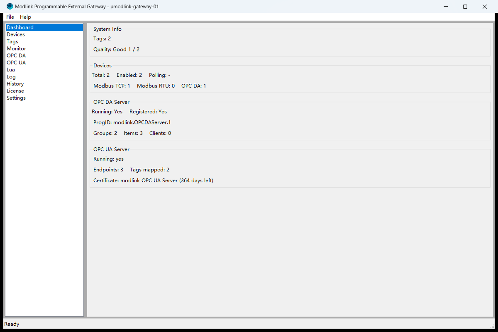
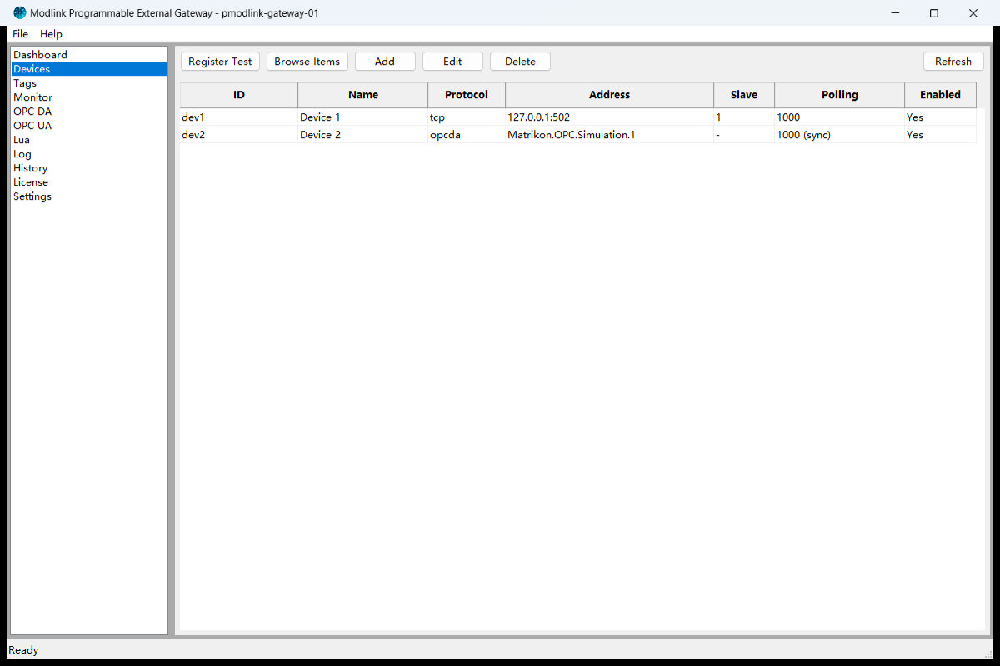
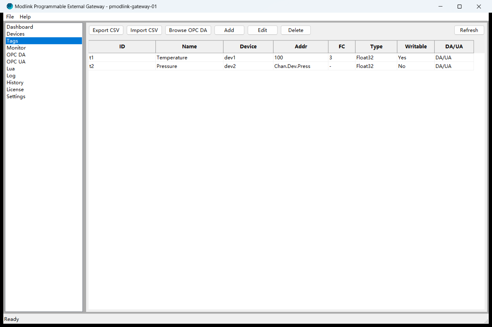
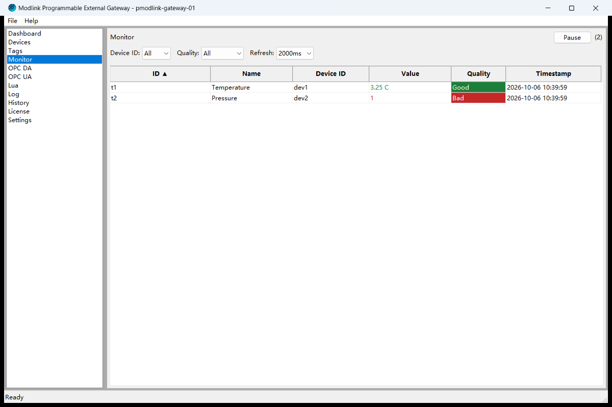
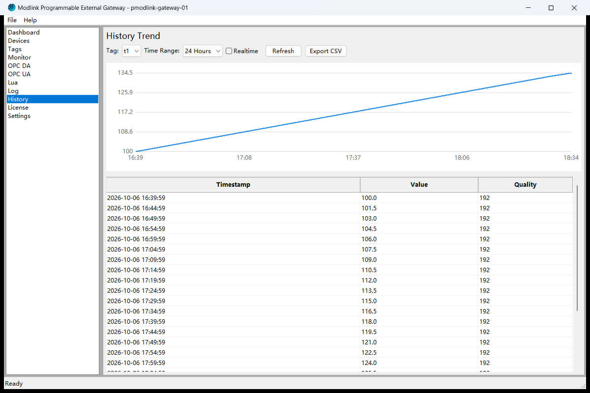
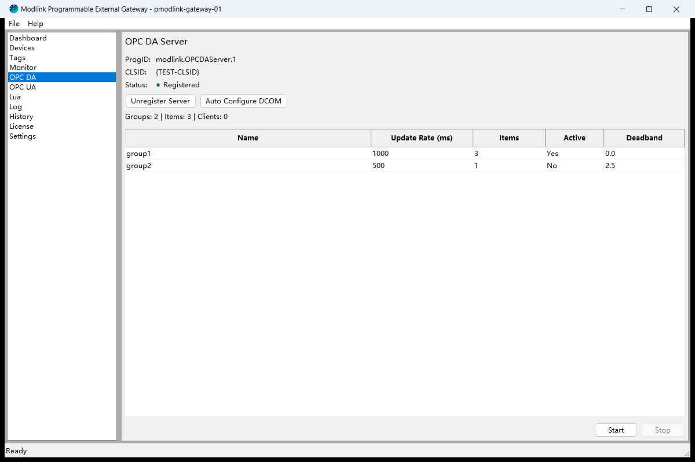
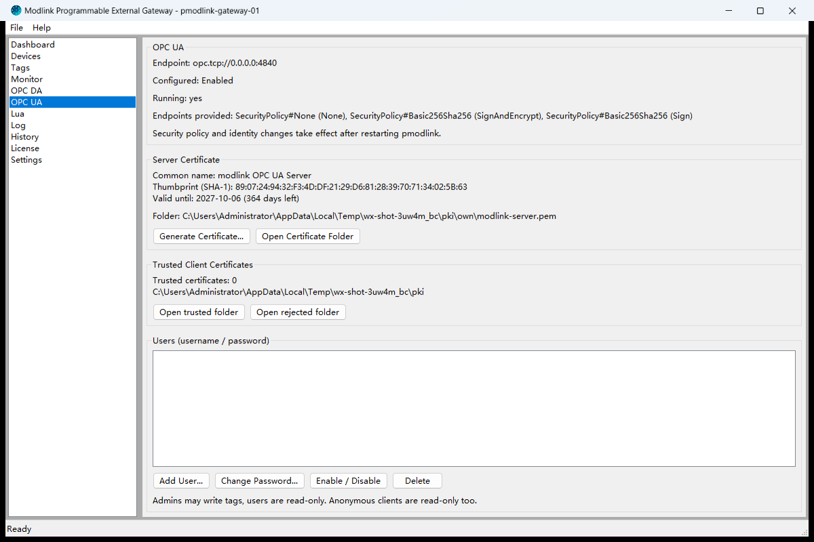
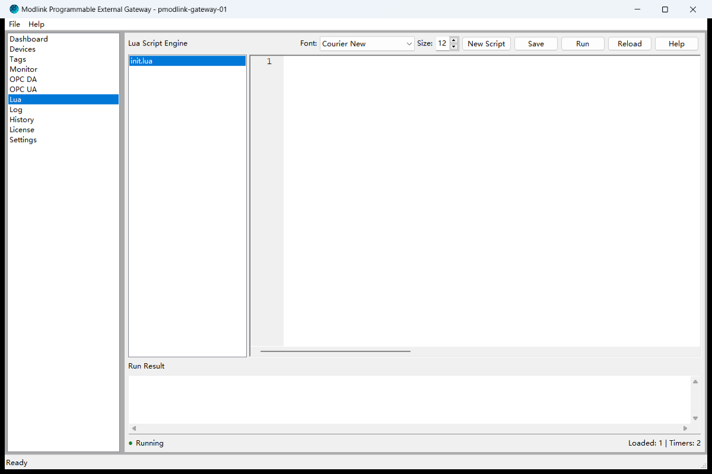
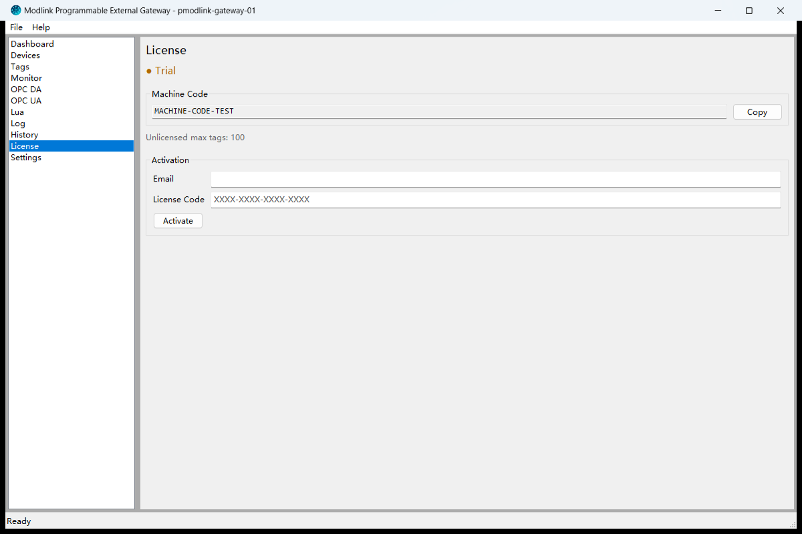

# pmodlink

**An industrial gateway for Windows that you script in Lua.** Collect data from Modbus
devices and OPC DA servers, publish the same tags over OPC DA and OPC UA, forward them
upstream over MQTT, and implement everything else in Lua scripts that run inside the
gateway.




> **Status: pre-release (1.4.1).** Features and license terms may change before the first
> production release.

---

## Contents

- [What it does](#what-it-does)
- [Capabilities](#capabilities)
- [Screenshots](#screenshots)
- [Architecture](#architecture)
- [Requirements](#requirements)
- [Installation](#installation)
- [Activation](#activation)
- [Documentation](#documentation)
- [Support](#support)
- [License](#license)
- [Safety notice](#safety-notice)

---

## What it does

Shop-floor equipment speaks Modbus, OPC DA, serial and one-off protocols. The systems
above it want OPC UA, OPC DA, MQTT or a database. pmodlink sits in between and keeps the
data honest on the way through:

```text
   Modbus TCP / RTU ──┐
   OPC DA servers   ──┤                    ┌─────────────→  OPC DA clients
   serial / TCP     ──┼──→  pmodlink  ─────┼─────────────→  OPC UA clients
   (via Lua)        ──┘     tag engine     ├─────────────→  MQTT uplink
                            + history      └─────────────→  Lua scripts, alarms
                            + Lua                           history database
```

Every tag carries a value, a quality and the moment it was acquired. When a device stops
answering, its tags keep their last known value but take a communication-failure quality,
so an operator sees stale data instead of a number that appears to be refreshing — and
OPC UA clients receive the matching status code with the original source timestamp. The
quality returns to good automatically once the device responds again.

## Capabilities

### Data acquisition

- **Modbus TCP** and **Modbus RTU** (serial), and **OPC DA** as a data source.
- Per-device polling interval, response timeout, retry count and retry delay.
- Per-tag configuration: register type (coil, discrete input, holding register, input
  register), data type, byte order, scaling factor, engineering unit, and whether the tag
  may be written to.
- Per-tag quality, as described above.
- A device dialog for test reads, and a browser for picking items from a live OPC DA
  server rather than typing item IDs.

### Serving and forwarding

- **OPC DA server** — publish collected tags to OPC DA clients, with configurable server
  identity, update rate, group limit, asynchronous mode and DCOM support.
- **OPC UA server** (default port 4840) — tag quality is reported to clients as OPC UA
  status codes, and the source timestamp is preserved from the moment of acquisition so
  that a client can distinguish a live value from a stale one. Three endpoints are offered
  — `None`, `Basic256Sha256_Sign` and `Basic256Sha256_SignAndEncrypt` — with anonymous,
  username/password and client-certificate identities. The server certificate is
  self-signed on first use into `data/pki/`; encrypted connections require the client's
  own certificate under `data/pki/trusted/certs/`, and a rejected client certificate is
  filed under `data/pki/rejected/` for inspection. Users and roles are managed on the
  **OPC UA** page: administrators may write tags, users and anonymous clients are
  read-only.
- **MQTT uplink** — publish tag values to a broker, with automatic reconnect.

### History

- Periodic sampling of tag values into a local database, with a configurable sampling
  interval and retention period.
- Views for browsing and querying archived values, with trend chart and CSV export.

### Scripting

pmodlink is extended with **Lua 5.4** scripts that run inside the gateway. Scripts can
read and write tags, react to tag-change events, run timers, raise alarms, query history,
keep state between runs, publish over MQTT, and open serial or TCP sessions to implement
custom protocols or arbitrary logic at the edge.

Scripting runs in a sandbox with configurable execution-time and memory limits and an
allow-list of modules. Script access to serial ports and network targets is disabled by
default and is enabled explicitly, with port and target allow-lists and timeout caps.

### Operations

- Runs as a desktop application or as a Windows service, with optional run at startup.
- Logging with a master on/off switch, selectable severity levels, optional log file
  output, an in-application log viewer and log export.
- License state, tag capacity and server status at a glance on the **Dashboard**.

### User interface

Dashboard, Devices, Tags, Monitor, History, Log, Lua, OPC DA, OPC UA, Browse, License and
Settings. The interface is available in English and Chinese.

## Screenshots

| | |
|:--:|:--:|
| <br>*Devices* | <br>*Tags* |
| <br>*Monitor — live values with per-tag quality* | <br>*History — trends and archived values* |
| <br>*OPC DA server* | <br>*OPC UA — certificates and user accounts* |
| <br>*Lua scripting* | <br>*License and activation* |

## Architecture

| Part | Role |
| --- | --- |
| `modlink/` — this Python package | The application: wxPython user interface, tag engine and quality model, polling schedulers (Modbus TCP/RTU, OPC DA client via pywin32), OPC UA server, MQTT uplink, history recorder, Lua host |
| `modlink_da.dll` — Rust, in `rust/` | Native OPC DA COM server (`modlink.OPCDAServer.1`, in-process and out-of-process activation) and offline license validation |
| SQLite database, `data/modlink.db` | Devices, tags, history samples, OPC UA users, settings |
| Lua 5.4 via `lupa` | User scripts, sandboxed, with optional serial/TCP access |
| `config/default.toml` | Annotated defaults; the effective configuration is read from it plus the database |

Everything is 32-bit, so the gateway can be deployed on old Windows 7 SP1 equipment as
well as on current Windows. The application is packaged with Nuitka into a standalone
directory (`dist\__main__.dist\`) that needs no Python installation on the target machine.

## Requirements

- **Windows 7 SP1 or later.** pmodlink is a 32-bit application and runs on 64-bit Windows.
  Service Pack 1 is a hard requirement — Windows 7 RTM is not supported.
- **On Windows 7 SP1, install KB2999226 (Universal C Runtime) before installing pmodlink.**
  The application imports the Universal C Runtime, so without this update it fails to start
  with a missing `api-ms-win-crt-*.dll` / `ucrtbase.dll` message. Windows 8.1 and later
  include it; on Windows 7 it comes from Windows Update or the Microsoft Update Catalog.
  [INSTALL.md](INSTALL.md) lists it in the pre-installation checklist.
- **No Visual C++ redistributable is needed** — the VC runtime DLLs (`vcruntime140.dll`,
  `msvcp140.dll`, `mfc140u.dll`) ship inside the application directory.
- Administrator rights to install.
- For OPC DA connectivity, the **OPC Core Components Redistributable (x86)** from the OPC
  Foundation must be installed on the machine. The OPC Core Components *SDK* is **not**
  sufficient — it does not contain the Automation Wrapper. This third-party runtime is not
  included with pmodlink.
- A license key for licensed operation.

> On Windows 7 the shipped `cryptography` 42.0.8 is the only usable version: from 43.0.3
> on its native module statically imports `bcryptprimitives!ProcessPrng`, an export that
> Windows 8 introduced, so a newer build cannot be loaded there.

## Installation

1. On Windows 7 SP1, install **KB2999226** (Universal C Runtime) first — see
   [Requirements](#requirements).
2. If OPC DA connectivity is required, install the OPC Core Components Redistributable
   (x86) first.
3. Run the pmodlink installer. Administrator rights are required; the default installation
   directory is under `Program Files`.
4. Start pmodlink, configure your devices and tags, then activate it on the **License**
   page.

The installation and deployment guide ([INSTALL.md](INSTALL.md)) covers the OPC Core
Components procedure in detail, together with Windows service installation, DCOM setup for
remote OPC DA access, and troubleshooting.

## Activation

Activation is offline and bound to the machine. The **License** page displays the machine
code for the computer; supply that code when ordering to receive a license key, and enter
the key on the same page. No internet connection is required, and no operational or
personal data is transmitted as part of activation.

Without a license key the application still runs, in an unlicensed mode with reduced
capacity. pmodlink is licensed per machine under a perpetual license, for up to 10,000
tags on the licensed machine; the limits currently in force are shown on the **License**
page. The [commercial license agreement](LICENSE.txt) is authoritative.

If a hardware change alters the machine code — a motherboard or network interface
replacement, for example — the application will ask to be re-activated. A replacement key
for the same licensed machine is issued at no charge.

## Documentation

- **[INSTALL.md](INSTALL.md)** — system requirements, the OPC Core Components
  Redistributable, remote OPC DA over DCOM, upgrading and backup, a troubleshooting table
  and a pre-delivery checklist.
- **Lua scripting reference** — built into the application. Open it with the **Help**
  button on the Lua page; it is also shipped as an offline manual.

INSTALL.md is written in English; the Lua scripting reference is currently in Chinese.

## Support

- Licensing, sales and upgrades: **support@pmodlink.com**
- Product website: **https://pmodlink.com/**

## License

**pmodlink is commercial, proprietary software. It is not open source.**

Use of the software is governed by the [ModLink Gateway Commercial License
Agreement](LICENSE.txt). In summary — and the agreement prevails — the license is
non-exclusive, non-transferable and non-sublicensable, it permits installation on the
number of computers stated in the license particulars, and each license key is bound to
one machine through its machine code. Reverse engineering, redistribution, and use of the
software to provide a hosted or managed service to third parties are not permitted.

## Safety notice

This software is intended for industrial data acquisition, monitoring and integration.
It is **not** designed, certified or intended for use in the control of machinery where a
malfunction could cause injury or death, in safety-instrumented or emergency shutdown
systems, in medical devices, or in any application requiring functional-safety
certification.

Read and write paths, Lua scripts, alarms and interlocks must be designed, tested and
validated by the integrator, with independent protection measures kept in place outside
this software. Any reading, write-back or control action performed through pmodlink is a
convenience function, not a safety function.
